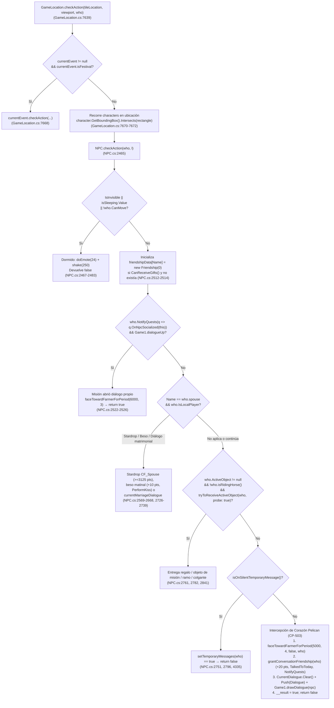

# Spike V-01 · Interceptar `NPC.checkAction` sin perder amistad, regalos ni misiones (`CP-010`)

- **Estado:** completada y verificada en vivo (2026-11-21) sobre Stardew Valley `1.6.15.24356` + SMAPI `4.5.2`, partida de desarrollo aislada `CorazonDev_454975123` y prototipo [`SpikesModule.cs`](../../CorazonPelican/Modules/SpikesModule.cs).
- **Decisión recomendada para [`CP-503`](../../backlog/tareas/CP-503-interceptar-conversacion.md):** aplicar un **Harmony Prefix sobre `NPC.checkAction(Farmer who, GameLocation l)`** que evalúe primero las guardas y ramas de mayor prioridad vanilla (invisibilidad, sueño, `!who.CanMove`, eventos/festivales, inicialización de `friendshipData`, misiones con diálogo propio, cónyuge y entrega de objetos activos con `tryToReceiveActiveObject(who, probe: true)`) y solo intercepte la rama de **conversación ordinaria**, invocando explícitamente `faceTowardFarmerForPeriod(5000, 4, false, who)`, `grantConversationFriendship(who)` y `Game1.drawDialogue(npc)` con `__result = true; return false;`.

---

## 1. Flujo completo de `GameLocation.checkAction` y `NPC.checkAction` (`1.6.15.24356`)



### Puntos críticos comprobados en el decompilado

1. **`grantConversationFriendship(Farmer who, int amount = 20)` (`NPC.cs:2924-2940`):**
   - Es un método `public void` de `NPC`.
   - Comprueba `!Name.Equals("Henchman") && !who.hasPlayerTalkedToNPC(Name) && who.friendshipData.TryGetValue(Name, out var value)`.
   - Marca `value.TalkedToToday = true`, invoca `who.NotifyQuests(quest => quest.OnNpcSocialized(this))`, duplica o triplica los puntos si el jugador tiene la bendición `"statue_of_blessings_4"` (`amount *= 3` → `+60`) y llama a `who.changeFriendship(amount, this)`.
   - **Implicación:** si ya se habló con el NPC ese mismo día (`TalkedToToday == true`), llamar de nuevo a `grantConversationFriendship(who)` en una segunda conversación del mismo día **es idempotente y no suma puntos duplicados**.

2. **Misión «Presentaciones» (`SocializeQuest.OnNpcSocialized`, `SocializeQuest.cs:97-115`) frente a otras misiones:**
   - `SocializeQuest.OnNpcSocialized(NPC villager)` elimina a `villager.Name` de `whoToGreet`, actualiza el objetivo (`total - whoToGreet.Count / total`) y devuelve `true`, **pero no abre ningún `DialogueBox` (`Game1.dialogueUp` sigue siendo `false`)**.
   - Por eso `NPC.cs:2522` evalúa `if (who.NotifyQuests((Quest quest) => quest.OnNpcSocialized(this)) && Game1.dialogueUp)`:
     - En *Introductions* (`SocializeQuest`), `NotifyQuests` avanza la misión en el acto y, como `Game1.dialogueUp == false`, la ejecución continúa hacia el saludo o diálogo del NPC.
     - En misiones que sí abren diálogo propio al hablar (`SlayMonsterQuest.cs:331-348`, `SecretLostItemQuest.cs:78-86`), `OnNpcSocialized` empuja su propio `Dialogue`, llama a `Game1.drawDialogue(npc)` (`Game1.dialogueUp == true`) y `checkAction` termina devolviendo `true`.

3. **Sondeo sin efectos laterales de regalos y entregas (`tryToReceiveActiveObject(Farmer who, bool probe = false)`, `NPC.cs:1713-1775`):**
   - El propio código vanilla (`NPC.cs:2782`) utiliza `tryToReceiveActiveObject(who, probe: true)` antes de decidir si la interacción es una entrega o una conversación.
   - Con `probe: true`, el método comprueba sin mutar estado:
     - `SpecialOrder.onItemDelivered(..., probe)` (`NPC.cs:1756-1774`);
     - `who.NotifyQuests(quest => quest.OnItemOfferedToNpc(this, activeObj, probe))` (`ItemDeliveryQuest`, `LostItemQuest`);
     - ramo de flores (`(O)458`), colgante de sirena (`(O)460`), té de polvo de estrellas (`(O)StardropTea`), objetos rechazados o límites diarios/semanales de regalo (`GiftsToday`, `GiftsThisWeek`).
   - Cuando devuelve `true`, basta con que el prefix devuelva `true` para que `NPC.checkAction` ejecute intacta toda la lógica vanilla de entrega.

4. **Por qué en vanilla un NPC sin líneas en `CurrentDialogue` no habla (`NPC.cs:2740-2780`):**
   - Tras la primera conversación del día, `DialogueBox` hace `Pop()` de `CurrentDialogue`, dejándola vacía (`CurrentDialogue.Count == 0`), y `checkForNewCurrentDialogue` devuelve `false`.
   - En vanilla, una segunda pulsación sin regalo no entra en `2749` ni en `2780` (`else if (canTalk() && CurrentDialogue.Count > 0)`), cayendo hasta el final del método (`return false`).
   - Con el prefix de Corazón Pelican, podemos abrir conversación en cualquier momento del día aunque `CurrentDialogue` estuviera vacía, sin perder la idempotencia de `grantConversationFriendship(who)`.

---

## 2. Matriz de casos y decisión del prefix

| Caso | Condición exacta en el prefix | Acción del prefix | Qué ocurre con amistad / misión / diálogo |
|---|---|---|---|
| **1. NPC no gobernado o mente/interceptación inactiva** | `!EsNpcGobernado(__instance)` | `return true` | 100 % vanilla. |
| **2. NPC invisible, dormido o jugador inmovilizado** | `__instance.IsInvisible \|\| __instance.isSleeping.Value \|\| !who.CanMove \|\| __instance.SimpleNonVillagerNPC \|\| !__instance.canTalk()` | `return true` | Si duerme (`isSleeping.Value`), vanilla hace `doEmote(24)` + `shake(250)` y devuelve `false`; si `!who.CanMove`, devuelve `false`. |
| **3. Evento o festival activo** | `Game1.CurrentEvent != null \|\| Game1.isFestival()` | `return true` | El diálogo del evento o festival corre por `Event.checkAction` / `CurrentEvent`. |
| **4. Primer contacto (sin entrada en `friendshipData`)** | `__instance.CanReceiveGifts() && !who.friendshipData.ContainsKey(__instance.Name)` | Crea `new Friendship(0)` antes de continuar | Requerido para que `grantConversationFriendship` encuentre la entrada en el primer saludo de la campaña (`NPC.cs:2512-2514`). |
| **5. Misión con diálogo propio (`SlayMonster`, `SecretLostItem`)** | `who.NotifyQuests(q => q.OnNpcSocialized(__instance)) && Game1.dialogueUp` | `faceTowardFarmerForPeriod(6000, 3, false, who); __result = true; return false;` | La misión muestra su diálogo de recompensa/avance y el NPC mira al jugador. |
| **6. Misión «Presentaciones» (`SocializeQuest`)** | `who.NotifyQuests(...)` devuelve `true` pero `Game1.dialogueUp == false` | Continúa hacia la conversación interceptada | `SocializeQuest.whoToGreet` elimina al NPC y además se muestra el diálogo de Corazón Pelican (+20 amistad). |
| **7. Cónyuge (`who.spouse`)** | `Name == who.spouse` con Stardrop pendiente (`>=3125` pts sin `CF_Spouse`), candidato a beso matinal (`<2200`, sin animación ni diálogo en cola, manos vacías) o `shouldSayMarriageDialogue && currentMarriageDialogue.Count > 0` | `return true` | Conserva el Stardrop de cónyuge, el beso diario (+10 amistad y eliminación de agotamiento) y las líneas matrimoniales vanilla. |
| **8. Regalo, entrega de misión, ramo o colgante en mano** | `who.ActiveObject != null && !who.isRidingHorse() && __instance.tryToReceiveActiveObject(who, probe: true)` | `return true` | Vanilla ejecuta `tryToReceiveActiveObject(who)`, consume el objeto, suma puntos de regalo, actualiza `GiftsToday`/`GiftsThisWeek` y abre el diálogo de reacción al regalo. |
| **9. Cooldown de burbuja temporal silenciosa** | `__instance.isOnSilentTemporaryMessage()` | `return true` | Respeta el enfriamiento vanilla de mensaje silencioso sin abrir caja de diálogo. |
| **10. Conversación ordinaria (primera o sucesivas del día)** | Resto de casos con `who.IsLocalPlayer` | `faceTowardFarmerForPeriod(5000, 4, false, who)` → `grantConversationFriendship(who)` → `CurrentDialogue.Clear()` → `CurrentDialogue.Push(new Dialogue(...))` → `Game1.drawDialogue(__instance)` → `__result = true; return false;` | Primera vez del día: `+20` amistad (o `+60` con bendición), `TalkedToToday = true`. Veces siguientes del mismo día: `+0` amistad, abre igualmente el diálogo de Corazón Pelican. |

---

## 3. Ejecución en multijugador (`who.IsLocalPlayer`, anfitrión vs cliente)

Del análisis de `GameLocation.cs:7672` y `NPC.cs:2569, 2749, 2784, 2806`:

1. **Dónde se invoca `NPC.checkAction`:**
   - Cuando un jugador pulsa acción sobre un NPC, `Game1.tryToCheckAt` → `GameLocation.checkAction` se ejecuta **en la instancia local del jugador que hizo clic** (sea el anfitrión o un cliente *farmhand* remoto).
   - Dentro de `NPC.checkAction(Farmer who, GameLocation l)`, `who` es siempre `Game1.player` en esa máquina (`who.IsLocalPlayer == true`).
2. **Dónde viven la amistad, las misiones y el `DialogueBox`:**
   - `who.friendshipData`, `who.questLog`, `tryToReceiveActiveObject(who)`, `grantConversationFriendship(who)` y `Game1.drawDialogue(this)` se ejecutan **en el cliente que interactúa** (`who.IsLocalPlayer`). Stardew sincroniza `friendshipData` por `NetFields` del `Farmer`.
3. **Dónde vive el motor de Corazón Pelican:**
   - Según ADS §2 y `HabitanteModule` (`LadoModulo.Anfitrion`), el `MotorHabitante`, la memoria y el puente HTTP hacia la `Mente` corren únicamente en el **anfitrión (`Context.IsMainPlayer`)**.
4. **Consecuencia arquitectónica para [`CP-503`](../../backlog/tareas/CP-503-interceptar-conversacion.md) y [`CP-404`](../../backlog/tareas/CP-404-selector-muletilla-contextual.md):**
   - El módulo de diálogo en `CorazonPelican` debe registrarse con `LadoModulo.Ambos` (igual que `SpikesModule`).
   - Si quien habla es el **anfitrión (`Context.IsMainPlayer`)**, el prefix consulta directamente al motor local.
   - Si quien habla es un **cliente remoto (`!Context.IsMainPlayer && who.IsLocalPlayer`)**, el prefix en el cliente:
     1. ejecuta localmente `faceTowardFarmerForPeriod` y `grantConversationFriendship(who)` (para que la amistad y las misiones del cliente suban de inmediato como en vanilla);
     2. abre la muletilla contextual inmediata en `Game1.drawDialogue` mientras envía un mensaje `Helper.Multiplayer.SendMessage` al anfitrión con el turno, o muestra la respuesta recibida del anfitrión por canal de mod (`Dr4co.CorazonPelican`).

---

## 4. Verificación en vivo (`CorazonDev_454975123`)

Pruebas ejecutadas con el prototipo [`SpikesModule.cs`](../../CorazonPelican/Modules/SpikesModule.cs) (`cp_v01 on`, `cp_v01_diag`) y el puente HTTP `Dr4coVoyagerBridge`:

1. **Estado inicial antes de hablar con Leah (Primavera 1, `09:30` / `14:00`):**
   ```text
   [Corazón Pelican] [V01-Diag] npc=Leah loc=LeahHouse@{X:3 Y:7} dormido=False evento=False festival=False tieneAmistad=False puntos=0 habladoHoy=False regalosHoy=0 regalosSemana=0 colaDialogo=1 objetoActivo=(ninguno) intro=[complete=False, remaining=26 [Abigail,Caroline,Clint,Demetrius,Willy,Elliott,Emily,Evelyn,George,Gus,Haley,Harvey,Jas,Jodi,Alex,Leah,Linus,Marnie,Maru,Pam,Penny,Pierre,Sam,Sebastian,Shane,Vincent]]
   ```

2. **Primera conversación del día con `cp_v01 on` (`POST /interact?x=10&y=23` en `SeedShop`):**
   - Respuesta de `POST /dialogue`:
     ```json
     {"success": true, "active": true, "menuType": "DialogueBox", "isQuestion": false, "messages": ["Hola desde Corazón Pelican: hoy hace buena luz junto al río."], "hasCharacterDialogue": true, "speaker": "StardewValley.NPC"}
     ```
   - Traza en consola de SMAPI:
     ```text
     [Corazón Pelican] [V01] Conversación interceptada npc=Leah | amistad 0->20 | habladoHoy False->True | regalosHoy=0 | enSocializeAntes=True enSocializeDespues=False | dialogueUp=True texto="Hola desde Corazón Pelican: hoy hace buena luz junto al río."
     [Corazón Pelican] [V01-Diag] npc=Leah loc=SeedShop@{X:10 Y:23} dormido=False evento=False festival=False tieneAmistad=True puntos=20 habladoHoy=True regalosHoy=0 regalosSemana=0 colaDialogo=0 objetoActivo=(ninguno) intro=[complete=False, remaining=25 [Abigail,Caroline,Clint,Demetrius,Willy,Elliott,Emily,Evelyn,George,Gus,Haley,Harvey,Jas,Jodi,Alex,Linus,Marnie,Maru,Pam,Penny,Pierre,Sam,Sebastian,Shane,Vincent]]
     ```
   - **Resultado:** la amistad subió `0 -> 20`, `TalkedToToday` pasó a `True` y `Leah` salió de `SocializeQuest.whoToGreet` (`remaining: 26 -> 25`).

3. **Segunda conversación el mismo día con `cp_v01 on`:**
   ```text
   [Corazón Pelican] [V01] Conversación interceptada npc=Leah | amistad 20->20 | habladoHoy True->True | regalosHoy=0 | enSocializeAntes=False enSocializeDespues=False | dialogueUp=True texto="Hola desde Corazón Pelican: hoy hace buena luz junto al río."
   ```
   - **Resultado:** vuelve a abrir el diálogo de Corazón Pelican sin duplicar puntos de amistad (`20 -> 20`).

4. **Entrega de regalo en mano (`(O)196` Salad en slot activo) con `cp_v01 on`:**
   - Respuesta de `POST /dialogue`:
     ```json
     {"success": true, "active": true, "menuType": "DialogueBox", "isQuestion": false, "messages": ["This looks delicious... Thank you! There's nothing quite like a fresh, wild salad."]}
     ```
   - Traza en consola de SMAPI y sensorio (`cp_escena leah`):
     ```text
     [Corazón Pelican] [V01] Paso a vanilla por regalo/objeto activo (npc=Leah, item=(O)196).
     [Corazón Pelican] [V01-Diag] npc=Leah loc=SeedShop@{X:10 Y:23} dormido=False evento=False festival=False tieneAmistad=True puntos=100 habladoHoy=True regalosHoy=1 regalosSemana=1 colaDialogo=2 objetoActivo=(ninguno)
     - suceso:regalo:0:-3354531154322050897:1 — regalo recibido de CorazonDev
     ```
   - **Resultado:** el prefix cedió el paso a vanilla, se consumió la ensalada, los puntos subieron `20 -> 100` (`+80`), `regalosHoy=1` y el sensorio detectó el suceso de regalo.

5. **Guardas de jugador inmovilizado (`!who.CanMove`) y NPC dormido (`isSleeping.Value == true`, Primavera 2 a las `00:10` en `LeahHouse@{X:2 Y:4}`):**
   ```text
   [Corazón Pelican] [V01] Paso a vanilla por guarda inicial (npc=Leah, inv=False, dorm=False, canMove=False).
   [Corazón Pelican] [V01-Diag] npc=Leah loc=LeahHouse@{X:2 Y:4} dormido=True evento=False festival=False tieneAmistad=True puntos=100 habladoHoy=True regalosHoy=1 regalosSemana=1 colaDialogo=2 objetoActivo=(ninguno)
   [Corazón Pelican] [V01] Paso a vanilla por guarda inicial (npc=Leah, inv=False, dorm=True, canMove=False).
   ```
   - **Resultado:** `activeMenu: null`, `dialogueUp: false`; no se abre diálogo cuando Leah duerme o el jugador no puede moverse.
